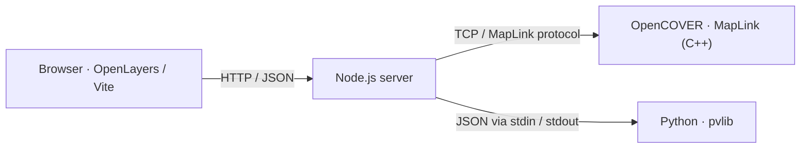

# PVision-Planner

Web interface for planning rooftop PV systems in VR and estimating their energy yield. PV modules are placed on a 2D map and visualized in OpenCOVER through the MapLink plugin.

## Architecture



The browser handles module placement, configuration, project management, and yield display. Node.js manages planning data and connects the browser to MapLink and Python. MapLink handles height queries, 3D module placement and removal, and map snapshots.

## Requirements

- COVISE/OpenCOVER with the compiled MapLink plugin on Windows or Linux.
- A compatible 3D scene, such as a `.wrl` file, plus the required model textures.
- Node.js and npm. The application was developed with Node.js 24.
- Python 3 and the packages required by the yield script, including `pvlib`. The application was developed with Python 3.11.
- Weather data for the yield calculation.

MapLink expects the PV module model at `share/covise/example-data/PV/PV_kompakt_hoch.obj` relative to `COVISEDIR`. Provide the OBJ and its material and texture files at the expected location, or adjust the path in MapLink. The 3D scene and sample data may need to be supplied separately.

## Setup and startup

1. **Install dependencies.** From the repository root, run:

   ```sh
   cd source
   npm install
   ```

   Install the Python dependencies from `requirements.txt` if supplied (`python -m pip install -r requirements.txt`). Otherwise, install the packages imported by the yield script. The server invokes `python`. On systems that only provide `python3`, use a virtual environment that provides `python` or adjust the server command.

2. **Start OpenCOVER.** Load the MapLink plugin and the 3D scene. The launch command and plugin path depend on the COVISE installation.

3. **Start the server.** In a terminal opened in `source/`, run:

   ```sh
   node server.js
   ```

   Check the connection status for MapLink initialization and project transformation synchronization.

4. **Start the frontend.** In another terminal opened in `source/`, run:

   ```sh
   npm run dev
   ```

   Open the URL printed by Vite and check the connection status in the application.

| Service | Local default |
| --- | --- |
| Vite frontend | <http://localhost:5173> |
| Node.js HTTP API | <http://localhost:8080> |
| MapLink TCP | `127.0.0.1:31822` |

For a split setup, configure Node.js with the reachable address of the OpenCOVER host and ensure TCP port `31822` is accessible from that host running Node.js. If the browser runs on another machine, configure the frontend with the reachable Node.js API address.

## Usage

- Draw a roof area from zoom level **18** and select the module type, orientation, tilt, and spacing. Confirm the layout to display the modules in OpenCOVER.
- OpenCOVER snapshots are requested from the same zoom level after the map stops moving. The snapshot camera is active only during capture.
- Edit or delete modules, clear layouts, and save or load projects in the browser.
- Run the yield analysis to view monthly and annual energy estimates.

## Yield calculation

The browser groups modules by calculation parameters and sends the groups and inputs such as location, module power, albedo, temperature coefficient, and system losses to `POST /calculate-yield`. Node.js starts `pv_calculation/ertragsberechnung.py`, passes JSON through `stdin`, and returns the JSON results from `stdout` to the browser. The Python process uses pvlib and weather data.

## Troubleshooting

- **MapLink connection fails:** Check that the plugin is loaded and that its configured host and TCP port are reachable.
- **3D modules are missing:** Check the connection status, project transformation, and PV OBJ path.
- **No snapshot appears:** Check that the map is at zoom 18 or higher and that MapLink is connected.
- **Yield calculation fails:** Check the Python command, installed packages, and weather data.
- **A port is already in use:** Check for another running instance of the service.

PVision-Planner is a research prototype. Placement accuracy depends on the available roof and 3D scene geometry. Energy yields are model-based estimates. The local HTTP setup is intended for development.